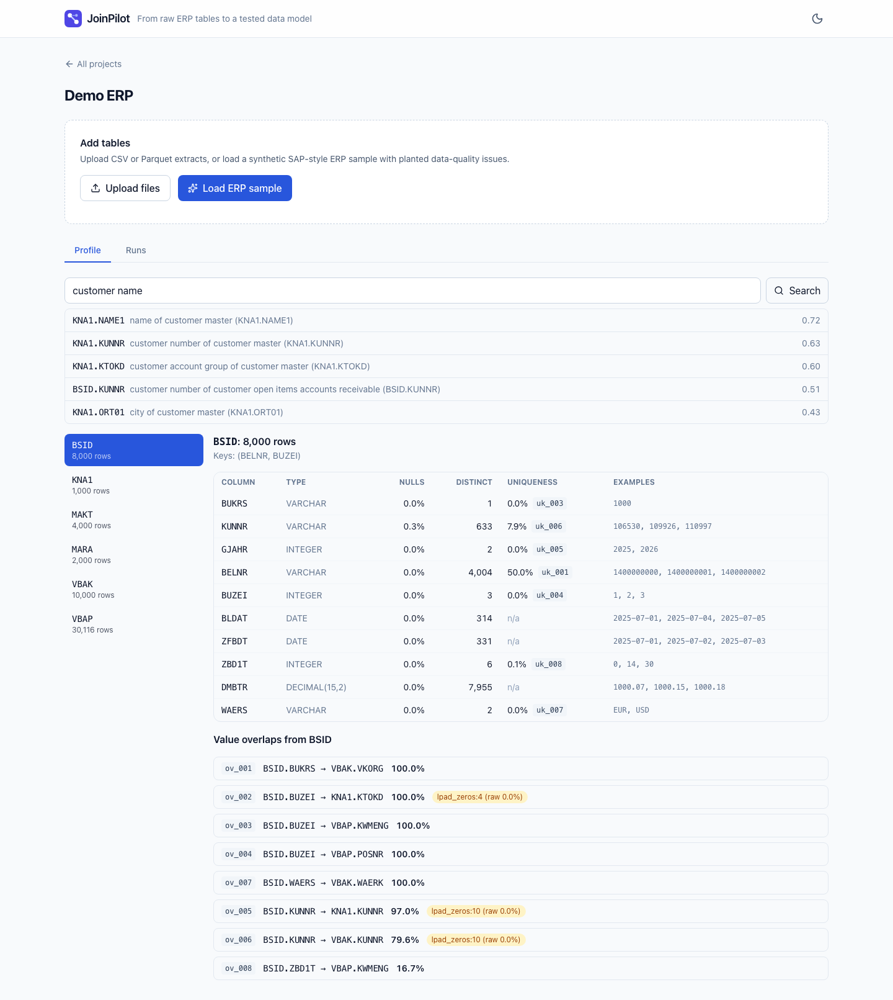
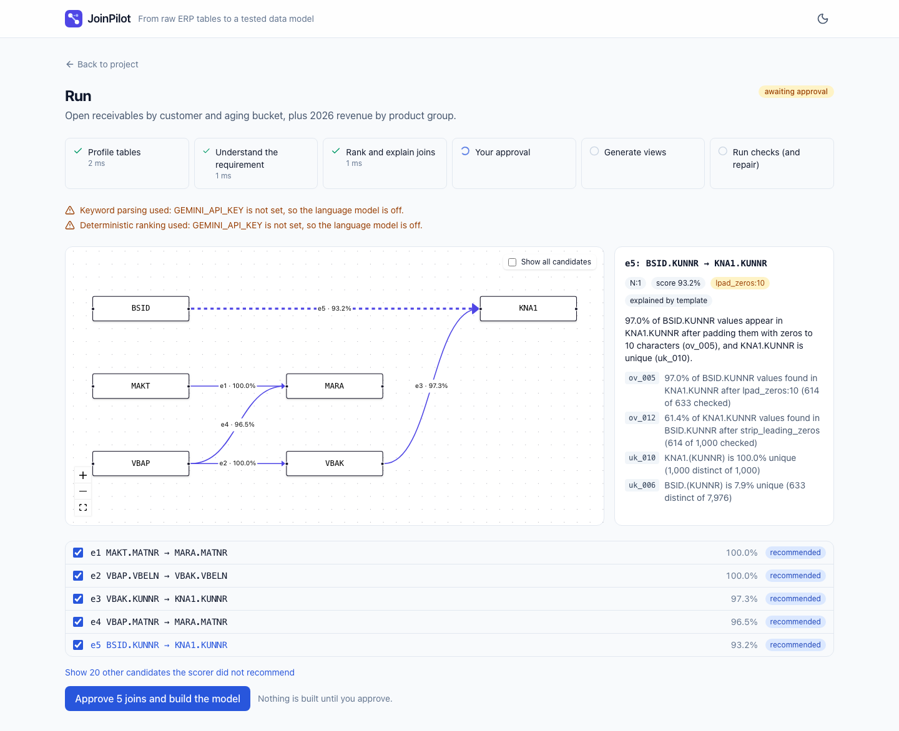

# JoinPilot

[](https://github.com/Karanpatel3114/joinpilot/actions/workflows/ci.yml)
[](LICENSE)

**Turn raw ERP tables and a plain-English requirement into a tested, human-approved data model.**

JoinPilot profiles your tables, proposes how they should be joined *with the numbers that prove it*, waits for a person to approve, then generates guarded SQL views, runs automated system-integration checks, builds a KPI dashboard and answers business questions in plain English. Other AI tools can drive it through an MCP server.

> Status: under active development. See the [build plan](docs/PLAN.md) for progress.

## Why

Analysts spend days studying cryptic ERP tables, guessing join keys, writing views and testing them by hand. One wrong key, a join that duplicates rows or records with no match silently corrupts the KPIs leaders rely on. JoinPilot makes each of those decisions explicit, evidence-backed and testable.

## How it works

1. **Upload** CSV or Parquet tables, or load the synthetic ERP sample.
2. **Profile** every column: types, nulls, distinct values, candidate keys and value overlap between columns.
3. **Describe** the requirement, for example *"Open receivables by customer and aging bucket, plus 2026 revenue by product group."*
4. **Review** the proposed join graph. Every join cites its evidence: overlap ratio, key uniqueness, cardinality, normalization (such as leading zeros) and fan-out risk.
5. **Approve** joins. Only then are SQL views generated, guarded and checked (row counts, fan-out, orphans, null keys, bucket coverage, reconciliation), with automatic repair.
6. **Use** the generated KPI dashboard, ask questions in plain English, or connect Claude through MCP.

## Console

**Profile.** Every column's type, nulls, distinct values and uniqueness, the value overlaps between tables, and a glossary search that finds columns by business words.



**Approve.** The proposed join graph. Each join opens its evidence: overlap ratio, key uniqueness, cardinality and the normalization it needed, such as padding customer numbers with zeros. Nothing is built until you approve.



**Results.** The generated SQL views (DuckDB, Postgres, Snowflake or BigQuery), ready to copy or download, and the integration checks, each showing what was observed and what was expected.


The screenshots are captured from the running app by a Playwright script: `cd web && SCREENSHOTS=1 npx playwright test screenshots`.

## Architecture

```
 web/ React console ──HTTP──▶ FastAPI (api/) ◀── mcp/ MCP server
                                  │
   profiling/ (DuckDB) · joins/ (candidates, scoring) · agent/ (LangGraph, human approval)
   sqlgen/ + guard (sqlglot) → sandbox DuckDB · checks/ · kpi/ · qa/ (text-to-SQL)
   db/ (Postgres + pgvector) · jobs/ (arq + Redis) · llm/ (Gemini · fake · Ollama)
```

## Tech stack

| Layer | Choice |
|---|---|
| Backend | Python 3.12, uv, FastAPI, Pydantic v2 |
| Agent | LangGraph with a Postgres checkpointer and human-in-the-loop interrupts |
| LLM | Google Gemini behind a provider interface; an offline fake provider for tests |
| Analytics | DuckDB (one sandboxed database per project), sqlglot SQL guard |
| App data | Postgres + pgvector, SQLAlchemy 2, Alembic |
| Jobs | arq + Redis |
| Web | React 19, Vite 8, TypeScript 7, Tailwind CSS 4, TanStack Query, React Flow, Recharts |
| Quality | pytest, Hypothesis, ruff, mypy (strict), oxlint, Vitest, Testing Library, Playwright |
| Ops | Docker, GitHub Actions, MCP (official Python SDK) |

## Quick start

```bash
uv sync                                        # backend
uv run uvicorn joinpilot.api.main:app --reload # API on http://localhost:8000
cd web && npm install && npm run dev           # console on http://localhost:5173
```

## Evaluation

Every number below comes from a file in [`eval/results/`](eval/results/), which records the split, dataset fingerprints, commit and date. Gold answers are written by the data generator and read only by `eval/`.

**Join discovery, dev split** (4 synthetic ERP datasets, 2026-11-26, commit `3566c20`, [results](eval/results/2026-11-26-3566c20-dev/metrics.md)):

| System | Precision | Recall | F1 | Normalization recall | Fan-out recall | Decoy rejection |
|---|---|---|---|---|---|---|
| Name-only baseline | 0.370 | 1.000 | 0.540 | 0.000 | 0.000 | 0.800 |
| Overlap-only baseline | 0.274 | 0.850 | 0.415 | 1.000 | 0.000 | 0.600 |
| Inclusion-dependency baseline (90% overlap into a unique column) | 1.000 | 1.000 | 1.000 | 1.000 | 0.000 | 1.000 |
| JoinPilot, deterministic (no LLM) | 1.000 | 1.000 | 1.000 | 1.000 | **1.000** | 1.000 |

How to read this honestly:
- The 20 true joins are one 5-join schema seen 4 times (3 seeds and 2 naming styles), so normalization and fan-out each rest on a single planted case.
- On dev, the textbook inclusion-dependency rule finds the same joins; uniqueness does most of the work. What JoinPilot adds here is flagging the fan-out trap (product texts in two languages) with the right filter, and an explanation for every decision.
- The deterministic scorer was tuned on this split. The held-out test split (new seeds, size M, both naming styles and TPC-H) is run once, at the end, and is where the methods are expected to differ. LLM-based systems are added in M4.

**Views and automated checks, dev split** (same run): every view the agent generated was valid and every check passed on the first try, both when every recommended join was approved without review and when only the true joins were approved (no repairs were needed; repairing bad approvals is covered by tests).

**SQL safety:** the guard blocked 100% of 63 red-team attacks (file and URL readers, other databases, recursive and oversized queries, stacked statements, DDL and DML, system functions, Unicode lookalikes and more) and wrongly blocked 0% of 11 ordinary analytics queries ([attacks](eval/redteam/sql_attacks.jsonl)).

## Data

All data is synthetic (a seeded ERP-style generator with planted data-quality issues) or public (TPC-H). SAP-style table names are a public naming convention used only for realism.

## Credits

Built by Karan Patel.

## License

[MIT](LICENSE)
