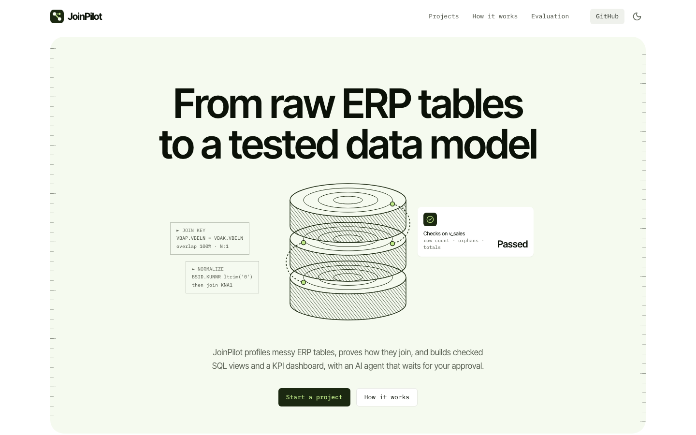
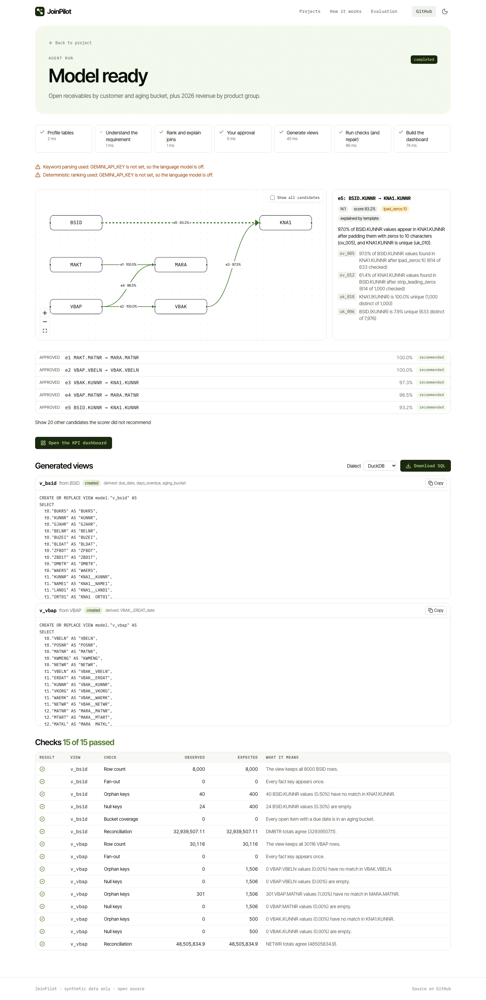
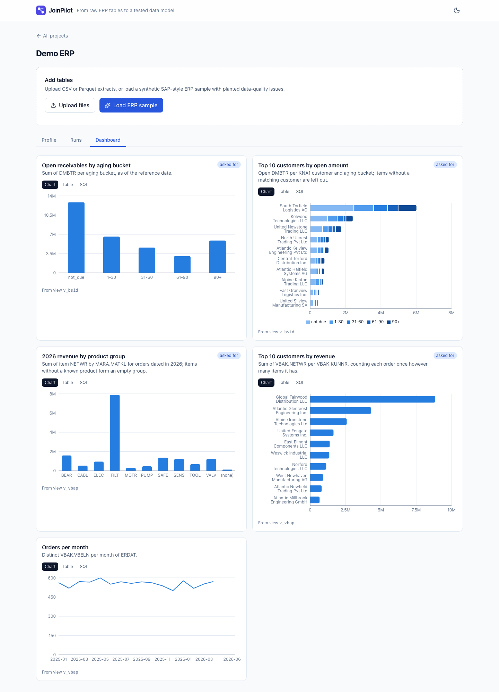
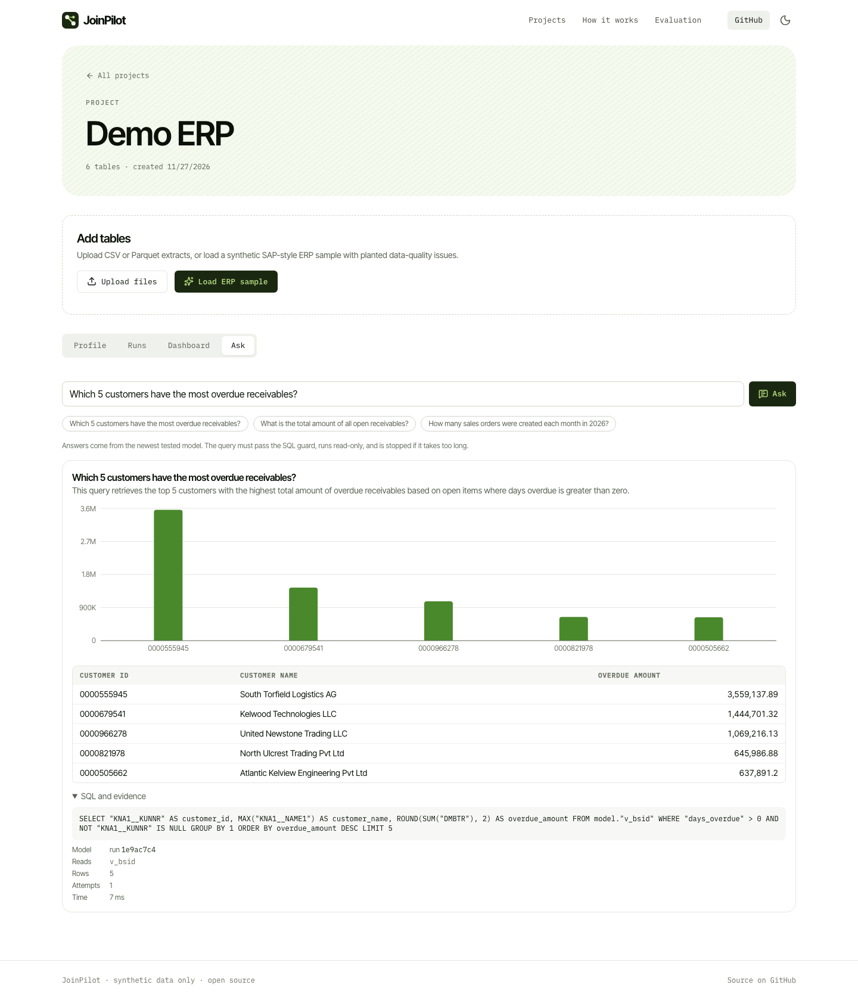
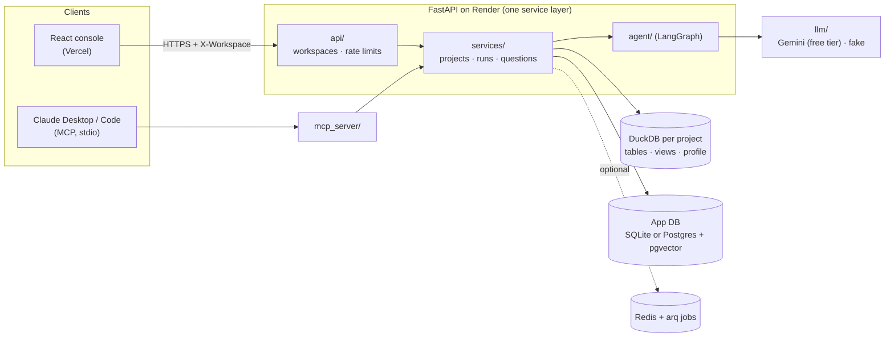
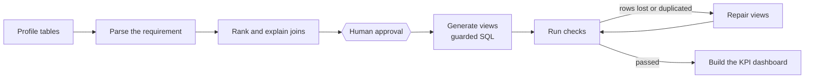

# JoinPilot

[](https://github.com/Karanpatel3114/joinpilot/actions/workflows/ci.yml)
[](LICENSE)

**Turn raw ERP tables and a plain-English requirement into a tested, human-approved data model.**

**Live demo: [joinpilot.vercel.app](https://joinpilot.vercel.app)**. Open the read-only sample project, or create your own and load the synthetic ERP data. No login; the free API may take about a minute to wake up on the first visit.

JoinPilot profiles your tables, proposes how they should be joined *with the numbers that prove it*, waits for a person to approve, then generates guarded SQL views, runs automated system-integration checks, builds a KPI dashboard and answers business questions in plain English. Other AI tools can drive it through an MCP server.

> Status: v1 complete. See the [build plan](docs/PLAN.md) for how it was built, one task per commit.

## Why

Analysts spend days studying cryptic ERP tables, guessing join keys, writing views and testing them by hand. One wrong key, a join that duplicates rows or records with no match silently corrupts the KPIs leaders rely on. JoinPilot makes each of those decisions explicit, evidence-backed and testable.

## How it works

1. **Upload** CSV or Parquet tables, or load the synthetic ERP sample.
2. **Profile** every column: types, nulls, distinct values, candidate keys and value overlap between columns.
3. **Describe** the requirement, for example *"Open receivables by customer and aging bucket, plus 2026 revenue by product group."*
4. **Review** the proposed join graph. Every join cites its evidence: overlap ratio, key uniqueness, cardinality, normalization (such as leading zeros) and fan-out risk.
5. **Approve** joins. Only then are SQL views generated, guarded and checked (row counts, fan-out, orphans, null keys, bucket coverage, reconciliation), with automatic repair.
6. **Use** the generated KPI dashboard, ask questions in plain English, or connect Claude through MCP.

## Console

**Home.** What JoinPilot does, with the measured results from the evaluation, then your projects.



**Profile.** Every column's type, nulls, distinct values and uniqueness, the value overlaps between tables, and a glossary search that finds columns by business words.


**Approve.** The proposed join graph. Each join opens its evidence: overlap ratio, key uniqueness, cardinality and the normalization it needed, such as padding customer numbers with zeros. Nothing is built until you approve.


**Results.** The generated SQL views (DuckDB, Postgres, Snowflake or BigQuery), ready to copy or download, and the integration checks, each showing what was observed and what was expected.



**Dashboard.** KPIs the approved model supports, the ones the requirement asked for first. Every metric can switch to its rows or the guarded SQL behind it.



**Ask.** Questions in plain English, answered by Gemini with read-only SQL that must pass the guard first. Each answer shows its chart, its rows, the exact SQL and what it read.



The screenshots are captured from the running app by a Playwright script: `cd web && SCREENSHOTS=1 npx playwright test screenshots`.

## Use it from Claude (MCP)

JoinPilot is also an MCP server. Claude Code or Claude Desktop can list projects, profile tables, propose joins, build and check the model after you approve it, read the dashboard and ask questions:

```bash
claude mcp add joinpilot -- uv run --directory /absolute/path/to/joinpilot joinpilot-mcp
```

The [MCP guide](mcp/README.md) covers Claude Desktop, the tools and the safety rules.

## Architecture



The agent is a LangGraph state machine that stops for a person before anything is built:



- **Deterministic first.** Profiling and join candidates are plain code with evidence ids; the model only ranks and explains candidates, and it cannot add a join that profiling did not find.
- **Every SQL statement is guarded.** Generated views and model-written questions pass a sqlglot allowlist, and questions run on a sealed, read-only DuckDB connection with no file or network access.
- **One service layer.** The API, the MCP server, the background jobs and the evaluation call the same functions, so the reported numbers come from the code that runs.

## Tech stack

| Layer | Choice |
|---|---|
| Backend | Python 3.12, uv, FastAPI, Pydantic v2 |
| Agent | LangGraph with human-in-the-loop interrupts and saved checkpoints (Postgres, or SQLite in the free demo) |
| LLM | Google Gemini behind a provider interface; an offline fake provider for tests |
| Analytics | DuckDB (one sandboxed database per project), sqlglot SQL guard |
| App data | Postgres + pgvector in Docker, SQLite in the free demo; SQLAlchemy 2, Alembic |
| Jobs | arq + Redis, or a thread in the API process (the free demo) |
| Web | React 19, Vite 8, TypeScript 7, Tailwind CSS 4, TanStack Query, React Flow, Recharts |
| Quality | pytest, Hypothesis, ruff, mypy (strict), oxlint, Vitest, Testing Library, Playwright |
| Ops | Docker, GitHub Actions, MCP (official Python SDK) |

## Quick start

```bash
uv sync                                        # backend
uv run uvicorn joinpilot.api.main:app --reload # API on http://localhost:8000
cd web && npm install && npm run dev           # console on http://localhost:5173
```

Or run the whole stack (Postgres, Redis, worker, API and console) in containers:

```bash
docker compose -f infra/docker-compose.yml --profile app up -d --build --wait   # console on http://localhost:8080
```

## Deploy for free

The live demo runs this way: the console on Vercel ([joinpilot.vercel.app](https://joinpilot.vercel.app)) and the API on Render's free plan ([health check](https://joinpilot-api.onrender.com/health)), with no payment method on either account. The step-by-step guide is [infra/DEPLOY.md](infra/DEPLOY.md).

## Evaluation

Every number below comes from a file in [`eval/results/`](eval/results/), which records the split, dataset fingerprints, commit and date. Gold answers are written by the data generator and read only by `eval/`.

### Final results: held-out test split

Run once, at the end, on data the heuristics were never tuned on: 12 synthetic ERP datasets (new seeds 101–103, encoded in the dataset ids; sizes S and M; both naming styles) plus TPC-H at scale factor 0.1 (2026-11-26, commit `1a22e17`, [results](eval/results/2026-11-26-1a22e17-test/metrics.md)). That is 13 datasets but only three schemas: the two ERP naming styles were also in dev, so only seeds and size are new there, and TPC-H is the one unseen schema (10 gold joins).

| System | Precision | Recall | F1 | Normalization recall | Fan-out recall | Decoy rejection |
|---|---|---|---|---|---|---|
| Name-only baseline | 0.274 | 0.986 | 0.429 | 0.000 | 0.000 | 0.800 |
| Overlap-only baseline | 0.213 | 0.871 | 0.343 | 1.000 | 0.000 | 0.600 |
| Inclusion-dependency baseline | 0.775 | 0.986 | 0.868 | 1.000 | 0.000 | 1.000 |
| JoinPilot, deterministic (no LLM) | **1.000** | 0.986 | **0.993** | 1.000 | **1.000** | 1.000 |

- **Joins:** 69 of 70 true joins found with no false positives. The one miss is TPC-H's two-column join from `lineitem (partkey, suppkey)` to `partsupp`: JoinPilot proposes single-column joins only (it uses two-column keys to spot fan-out), so no system can find it yet. The inclusion-dependency baseline, which matched JoinPilot on dev, proposes 20 wrong TPC-H joins here (small integer columns such as `l_linenumber` fit inside every key range).
- **Views and checks:** 26 of 26 generated views were valid and 209 of 209 checks passed on the first try, both with every recommended join approved and with only the true joins approved.
- **KPIs:** **1,248 of 1,248** gold values right across the 12 ERP datasets (TPC-H has no KPI templates).
- **SQL safety:** 71 of 71 attacks blocked and 0 of 11 ordinary queries wrongly blocked; the stricter mode for model-written questions refuses 2 of the 11 (both pad keys by hand). These are the same fixed queries as on dev, so they test the guard, not generalisation.
- **With the language model:** question answering and the model-ranked join systems were measured later, on the dev split only (below); the test split stays a single run. TPC-H numbers here are not official TPC-H benchmark results.

### Development results: dev split

**Join discovery, dev split** (4 synthetic ERP datasets, 2026-11-26, commit `e376633`, [results](eval/results/2026-11-26-e376633-dev/metrics.md)):

| System | Precision | Recall | F1 | Normalization recall | Fan-out recall | Decoy rejection |
|---|---|---|---|---|---|---|
| Name-only baseline | 0.370 | 1.000 | 0.540 | 0.000 | 0.000 | 0.800 |
| Overlap-only baseline | 0.274 | 0.850 | 0.415 | 1.000 | 0.000 | 0.600 |
| Inclusion-dependency baseline (90% overlap into a unique column) | 1.000 | 1.000 | 1.000 | 1.000 | 0.000 | 1.000 |
| JoinPilot, deterministic (no LLM) | 1.000 | 1.000 | 1.000 | 1.000 | **1.000** | 1.000 |

How to read this honestly:
- The 20 true joins are one 5-join schema seen 4 times (3 seeds and 2 naming styles), so normalization and fan-out each rest on a single planted case.
- On dev, the textbook inclusion-dependency rule finds the same joins; uniqueness does most of the work. What JoinPilot adds here is flagging the fan-out trap (product texts in two languages) with the right filter, and an explanation for every decision.
- The deterministic scorer was tuned on this split. The held-out test split above was run once, at the end.

**Views and automated checks, dev split** (same run): every view the agent generated was valid and every check passed on the first try, both when every recommended join was approved without review and when only the true joins were approved (no repairs were needed; repairing bad approvals is covered by tests).

**KPI correctness, dev split** (same run): with the recommended joins approved, the generated dashboard got **416 of 416** gold KPI values right (100%): open receivables by aging bucket, the top 10 customers by open amount per bucket, 2026 revenue by product group, monthly order counts and the top 10 customers by revenue, in both naming styles. Counts must match exactly, money within 0.01%, and a row the app adds that gold does not have counts against it. KPI correctness is measured only on the synthetic ERP schema the templates were written against; the test split adds new seeds and a larger size of that schema, and on other schemas (TPC-H included) the templates may simply not apply.

**SQL safety** (same run): the guard blocked 100% of 71 red-team attacks (file and URL readers, other databases, recursive queries, values grown to gigabytes from tiny input, parser crashes, stacked statements, DDL and DML, system functions, Unicode lookalikes and more) and wrongly blocked 0% of 11 ordinary analytics queries ([attacks](eval/redteam/sql_attacks.jsonl)). The stricter mode used for model-written questions also refuses 2 of those 11, both of which pad customer keys by hand; the model views already do that.

**With the language model, dev split** (gemini-3.5-flash-lite on Google's free tier, 2026-11-27, commit `7c4b16b`, [results](eval/results/2026-11-27-7c4b16b-dev/metrics.md); the model join systems are in its `metrics.json`):

- **Question answering:** **120 of 160** questions answered exactly right (75.0%), with 1.02 attempts per question on average. Every refusal counts as wrong: 10 questions got no answer because the free tier refused the calls after retries (`LLM_UNAVAILABLE` in the results), and 2 queries failed to run. By kind of question: duplicates 93.8%, plain lookups 79.2%, null keys 75.0%, orphans 70.8%, normalization 40.0%. The common mistakes, from the SQL recorded per question in `metrics.json`, are model errors: filtering by a customer number without its leading zeros, counting products from order items instead of the product master, and `SUM(DISTINCT ...)` on amounts.
- **Join discovery with the model:** both model-based systems reached F1 1.000 in each of 3 runs. A model that sees only the schema (`llm_only`) found the right joins but caught 0 of 4 leading-zero key mismatches and none of the fan-out risks; JoinPilot with the model (`joinpilot_full`) matched the deterministic scorer on everything and wrote an explanation for every candidate. On this data the model adds explanations, not accuracy.

## Limitations

- **Synthetic data.** The ERP data is generated, with planted issues, so that the right answers are known. Real ERP systems have hundreds of tables and messier names; JoinPilot caps a project at 30 tables and 200 columns per table.
- **Narrow test coverage.** The test split is one 5-join ERP schema (new seeds, two sizes, two naming styles) plus TPC-H, so normalization and fan-out each rest on a few planted cases. Composite (two-column) joins are not proposed yet, which is the one join missed on TPC-H.
- **KPI templates** are written for the receivables and sales schema; on other schemas the dashboard may have no metrics.
- **Question answering** is measured on the dev split only, with one model: 75% exact answers, and weakest on questions that need key normalization. The free tier's rate limits and daily quota also cap how many questions the demo can answer.
- **Workspaces are not accounts.** The public demo keeps visitors apart with a random id stored in the browser, like an unguessable link. Clearing browser storage loses the projects, and the free host wipes everything when it restarts.
- **Free hosting** sleeps after 15 idle minutes, so the first visit can take about a minute.

## Data

All data is synthetic (a seeded ERP-style generator with planted data-quality issues) or public (TPC-H). SAP-style table names are a public naming convention used only for realism.

## Credits

Built by Karan Patel.

## License

[MIT](LICENSE)
